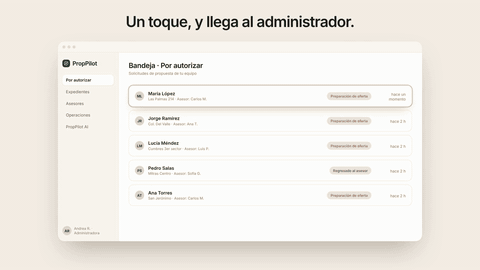
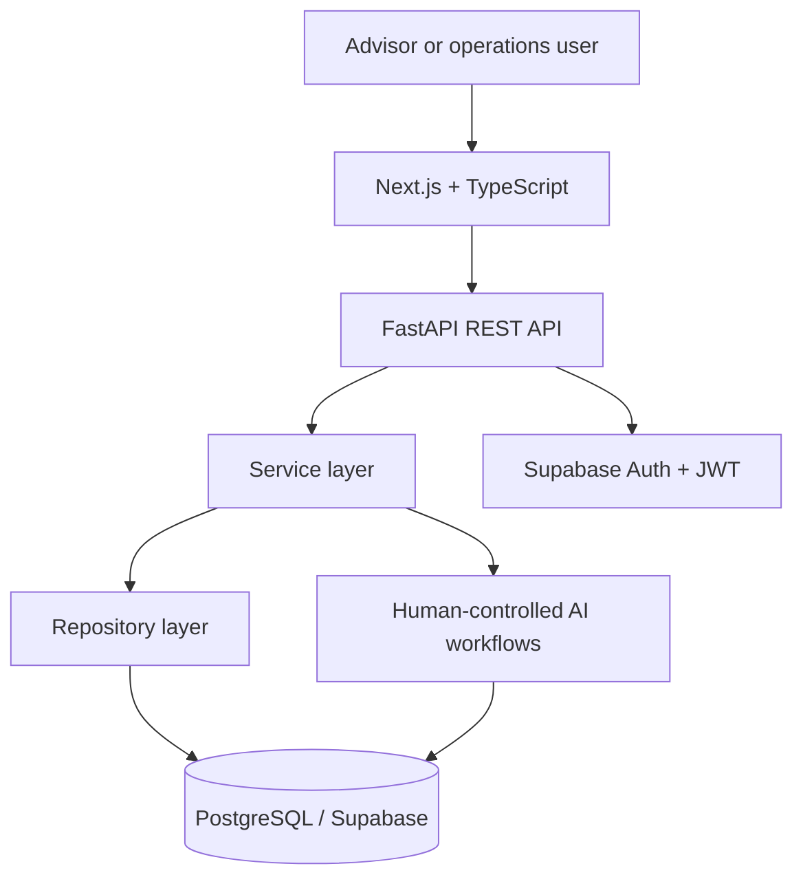

# PropPilot · Oniria

  <strong>AI-first real-estate operations, built from real customer and workflow problems.</strong>

The public product is available at **[state-ai-frontend.vercel.app](https://state-ai-frontend.vercel.app/)**.

PropPilot is an AI-first CRM for real-estate advisors and acquisition teams. It turns fragmented conversations, property information, documents, debts, tasks, and negotiations into a structured operating workflow.

This repository is a **sanitized public product and engineering case study**. The application source, prompts, credentials, schemas, and client data remain private.

## Product in motion

  <strong><a href="https://state-ai-frontend.vercel.app/">Open the live PropPilot product →</a></strong>

This short sequence comes from the product commercial and shows how PropPilot turns an incomplete property file into an actionable workflow. The public experience uses presentation data; production source code and customer information remain private.

## Why I built it

Real-estate work rarely begins with a clean specification. Context is distributed across WhatsApp messages, calls, notes, spreadsheets, documents, and the memory of individual advisors.

I started PropPilot from direct exposure to those workflows. The product challenge was not simply to build another CRM; it was to translate ambiguous operational problems into a system that people could actually use while protecting sensitive customer information.

## My role

**Oniria product · Founder and lead engineer — Emiliano González Romo**

- Customer and workflow discovery from real-estate operations.
- Product definition, prioritization, and domain modeling.
- Frontend and backend architecture.
- API, authentication, and data-model design.
- Applied-AI workflow design with human confirmation.
- Testing, debugging, documentation, version control, and CI/CD.
- Iteration around feedback and real operational constraints.

## What the product organizes

| Operational area | Product approach |
| --- | --- |
| Leads and contacts | Shared customer context and role-based records |
| Properties | Characteristics, documentation, status, and related parties |
| Acquisition cases | Structured case files for ownership, property condition, debts, and offers |
| Opportunities | Stage-based commercial pipeline |
| Follow-up | Tasks, appointments, activities, and notifications |
| Knowledge retrieval | Conversational summaries and filters over authorized CRM context |
| AI-assisted actions | Recommendations and controlled actions with human review |

### Property-acquisition workflow

Rejected and cancelled cases are kept outside the active sales flow so the working pipeline stays focused.

## Architecture

| Layer | Main technologies |
| --- | --- |
| Web application | Next.js, React, TypeScript |
| API and domain logic | FastAPI, Python, Pydantic v2 |
| Persistence | PostgreSQL, Supabase, SQLAlchemy 2.0 |
| Database evolution | Alembic migrations |
| Authentication | Supabase Auth, JWT |
| Delivery practices | Git, GitHub, GitHub Actions, automated testing |
| Applied AI | Structured extraction, contextual retrieval, recommendations, human-in-the-loop actions |

The backend follows a **Route → Service → Repository** separation to keep transport, business rules, and persistence concerns explicit.

## Applied AI — with operational boundaries

PropPilot explores AI where it can reduce search and coordination work:

- Conversational retrieval over leads and case files.
- Context summaries and operational filters.
- Structured extraction from quick notes.
- Follow-up recommendations.
- Detection of overdue and upcoming activity.
- Creation of tasks, activities, or notifications through controlled workflows.

The product does **not** present AI as an autonomous closer. Actions that affect operational records are designed around user review or confirmation.

## Security and privacy

Real-estate records may contain highly sensitive personal and financial information. The project therefore treats privacy as a product requirement:

- Explicit allowlists for fields that may be processed by an LLM.
- Explicit exclusions for fields that must never be sent to an LLM.
- Pydantic validation at API boundaries.
- Authentication and role-aware access patterns.
- Environment-based configuration and no committed credentials.
- Sanitized public documentation with no client names or records.

## Engineering approach

The project is developed through small, reviewable increments:

1. Observe an operational problem.
2. Translate it into a workflow and acceptance criteria.
3. Model the affected domain and data.
4. Implement across frontend, API, and persistence.
5. Test and debug the complete flow.
6. Validate the behavior against the original operational need.
7. Document decisions and deploy through version-controlled workflows.

This is the kind of work I want to continue doing as a **Forward Deployed / AI Solutions Engineer**: working close to users, understanding an unclear problem, and carrying a practical solution from discovery into implementation.

## Current status

**Operating inside Crestify.** PropPilot is a completed working system used in a real-estate operation. The current product centralizes acquisition cases, property and debt context, proposals, follow-up, permissions, and controlled AI assistance. Oniria is now preparing the architecture, configuration boundaries, onboarding, and deployment process required to expand PropPilot to additional real-estate companies.

## Public links

- [Live portfolio](https://h8hyf2rw9y-afk.github.io/Portfolio/)
- [Primary GitHub profile](https://github.com/h8hyf2rw9y-afk)
- [LinkedIn](https://www.linkedin.com/in/emiliano-gonzalez-tech/)

---

### Resumen en español

PropPilot es el producto inmobiliario de Oniria, construido desde problemas reales de operación y actualmente utilizado dentro de Crestify. Centraliza prospectos, propiedades, expedientes, oportunidades y seguimiento, e incorpora asistencia de IA con límites claros, protección de datos y control humano. El código y los datos se mantienen privados; este repositorio presenta públicamente el problema, mi contribución, la arquitectura y las decisiones de ingeniería.
